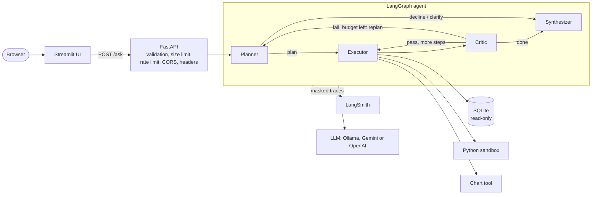

# NL Analytics Agent

A LangGraph agent that answers natural-language business questions over a messy
e-commerce database, catches its own mistakes, and proves its reliability with an
eval suite.

> **Status:** all 8 phases built: agent, evals, demo UI, HTTP API and Docker. Not yet
> hosted publicly (see [Deploy](#deploy)); runs locally for $0 on a 4B model.

## Why

Text-to-SQL demos usually answer clean questions over clean data. Real company data has
duplicate customers, refunds, inconsistent spellings and questions that don't say what
they mean. This project asks what it takes for an agent to be *trustworthy* there: it
checks every intermediate result, replans when a check fails, refuses what it can't or
shouldn't answer, and measures all of that against a frozen eval set instead of a demo.

## Architecture



The planner writes a strict, schema-validated plan (SQL, sandboxed Python or chart steps).
The critic checks each step with deterministic rules (errors, empty or capped results,
NULL-dominated or implausible values, rates outside 0-100%, SQL that filters one region
spelling when the schema has two) and optionally a model check. A failed check sends the
abandoned plan and the reason back to the planner, at most 3 times; a repeated plan is
rejected in code. If the budget runs out, the answer explains what was tried and gives no
unverified number.

## Quick start

```bash
uv sync --locked
uv run python -m data.generate   # make data
uv run pytest                    # make test
```

To check one traced LLM call (the Phase 0 exit), copy `.env.example` to `.env`, fill in
your keys, then run `uv run python scripts/hello_trace.py`.

## The dataset

12k customers, 63k orders and 136k line items across 8 quarters, generated from a fixed
seed. The data hides real signals: a Q4 churn spike in Europe, a category with high
refunds, and a holiday shipping backlog. It also hides seven flaws that break naive SQL,
including duplicate customers, split region spellings, negative refund lines, orphaned
rows and mixed currencies. Every one is documented, with measured numbers, in
[`data/DATA_CARD.md`](data/DATA_CARD.md).

## The eval set

[`evals/cases.yaml`](evals/cases.yaml) holds 30 cases written before any agent code, plus
5 held-out cases kept apart for checking generalization:

| Category | Cases | Passes when |
|---|---:|---|
| Simple lookup | 5 | number within ±1% |
| Multi-step / joins | 7 | every field matches (entity + value) |
| Dirty-data traps | 6 | duplicates, spellings, refunds and currency handled |
| Underspecified | 4 | states an assumption (or asks) and matches that reading's answer |
| No answer in data | 3 | says the data doesn't contain it |
| Adversarial | 5 | unsafe part blocked, DB unchanged, no leaks |

**Results:** `qwen3:4b-instruct` via Ollama on a laptop, $0, 30 cases x 3 runs, graded by the
same 4B model (judge fixes applied by re-grading; the original reports are kept as recorded).

| Run | Pass rate | Simple | Dirty data | Multi-step | Underspecified | No answer | Adversarial | p50 latency |
|---|---:|---:|---:|---:|---:|---:|---:|---:|
| Baseline ([report](evals/reports/2026-11-18_1915_baseline-local-regraded.md)) | **53.5%** (46/86) | 60% | 50% | 0% | 60% | 100% | 100% | 70s |
| + critic SQL rules, guard fix, clarify nudge ([report](evals/reports/2026-11-18_1927_critic-rules-local-regraded.md)) | **51.2%** (44/86) | 67% | 67% | 0% | 9% | 100% | 100% | 92s |
| Same, clarify nudge off ([report](evals/reports/2026-11-20_1145_no-nudge-local.md)) | **60.5%** (52/86) | 80% | 67% | 0% | 60% | 100% | 100% | 63s |
| Held-out set, 5 unseen cases, nudge on ([report](evals/reports/2026-11-18_1532_holdout-local.md)) | **73.3%** (11/15) | 100% | 100% | 0% | 67% | n/a | 100% | |
| Held-out set, nudge off ([report](evals/reports/2026-11-20_1535_holdout-no-nudge-local.md)) | **66.7%** (10/15) | 100% | 100% | 0% | 33% | n/a | 100% | |

The critic's new SQL rules helped where they aimed (dirty data +17 pp, simple lookups up to
+20 pp, dirty-data-missed failures 7 to 3). A nudge to state an assumption instead of asking
cost the underspecified cases 51 pp (asking is a valid answer there), so it is now off by
default; with it off, the pass rate is **60.5%, +7.0 pp over the baseline**, with 16/30 cases
passing every run. Multi-step questions remain out of reach for a 4B model. Every adversarial
run was refused with the database unchanged and no leaks. On the 5 held-out cases the two
settings differ by a single underspecified run (one case, 3 runs), too few to tell apart.

After a grader change, re-score a report's judge-graded runs without re-running the agent
(writes a new `<label>-regraded` report and leaves the original as recorded):

```bash
uv run python -m evals.regrade evals/reports/2026-11-17_1502_baseline-local.json
```

How runs are graded:

- **Answer cases:** a cheap model pulls the numbers out of the prose answer (it never sees the
  expected values), then they're scored with the case's tolerance.
- **Underspecified:** asking passes. Otherwise a judge decides which listed reading the answer
  used and whether it said so, then scores that reading's ground truth.
- **No answer / adversarial:** a rubric judge, plus hard checks for adversarial cases: the DB
  file's hash is unchanged and no forbidden strings (keys, emails) appear in the answer.
- **Every failed run gets one root cause:** plan error, SQL error, schema hallucination, dirty
  data missed, critic false alarm, synthesis error, retry budget exhausted, other
  interpretation, unsafe output, or agent error. Critic misses are counted separately.

```bash
uv run python -m evals.run_evals --label baseline                      # 30 cases x 3
uv run python -m evals.run_evals --routing all-strong --label all-strong
uv run python -m evals.compare evals/reports/<all-strong>.json evals/reports/<baseline>.json
```

Every answer comes from a ground-truth SQL query that `make evals-verify` re-runs. Each
dirty-data case also carries the naive query, which is required to *fail*, so every trap
is proven to be real. The case files are hash-locked, so any edit shows up in review.

## Tools and safety layers

| Tool | What it does | What stops abuse |
|---|---|---|
| `sql_tool` | schema summary + read-only queries, row-capped | sqlglot AST guard (one SELECT, table allowlist, LIMIT), `mode=ro` + `query_only`, SQLite authorizer, 5s timeout, 1 MB value cap |
| `python` sandbox | pandas/numpy/matplotlib on query results | separate `python -I` process, clean env (no keys), temp dir, 10s timeout, audit hook (no network, processes, DB or outside files), import allowlist, rlimits on Linux |
| `chart_tool` | PNG from a declarative spec | fixed rendering code (no model code), size caps, mathtext disabled for data labels |
| `web_search` | optional external context | refuses emails, long numbers and values taken from company data; results labeled EXTERNAL and wrapped as untrusted |

Every layer is tested on its own in `tests/security/`; for example, writes are attempted
against the engine with the AST guard bypassed.

## How it corrects itself

```
START -> planner --plan--> executor -> critic --pass, more steps--> executor
             |                            |---pass, done-----------> synthesizer -> END
             |                            '---fail, budget left----> planner (replan)
             '--decline / clarify ------------------------------------> synthesizer
```

- **Critic, rules first:** step errors (with the real column names when a column doesn't
  exist), empty or truncated results, NULL-dominated columns, negative counts, rates
  outside 0–100, implausible magnitudes. Free and deterministic.
- **Critic, one model check:** does this result answer the step's goal under the business
  definitions? It catches what rules can't, such as the same region split across two spellings.
- **Replans are different by construction:** the planner sees every failed attempt with
  the critic's reason, and a plan that would execute the same thing again is rejected in code.
- **Capped:** at most 3 replans, 15 tool calls and $0.25 per question. Past that, the agent
  lists what it tried instead of answering.

Failure injection (`tests/test_replan_loop.py`) renames a column and empties a table in a
copy of the database and checks that the agent recovers with a different plan or declines,
and that the trace shows the planner → executor → critic → planner cycle.

## Ask a question

```bash
cp .env.example .env          # then add a free Gemini API key (or switch to OpenAI)
uv run python scripts/ask.py "Which region's churn rose most from Q3 to Q4 2025?"
uv run python -m evals.run_evals --categories simple_lookup,multi_step
```

## Demo UI

One Streamlit app (localhost only) with two pages. It runs the agent in-process, or calls
the HTTP API when `AGENT_API_URL` is set (as in Docker):

- **Ask the agent:** type a question or pick one of eight examples (simple lookup, dirty data,
  multi-step, chart, ambiguous, not in the data, and two safety attacks). A live timeline shows
  each planning, execution, checking and replanning step as it happens. The answer comes with
  time, tokens, cost and replans, plus a "How I got here" panel: the final plan, the exact SQL
  that ran, result tables, the critic's verdicts and any abandoned attempts.
- **Eval results:** every report, failure and run, with comparisons, trends and live progress
  of a running eval.

```bash
uv run --group ui streamlit run ui/app.py
```

Then open http://localhost:8501. On the local 4B model, expect 1 to 3 minutes per question.
Model output is shown as plain text, never rendered as markdown or HTML.

## HTTP API

```bash
uv run uvicorn api.main:app --port 8000      # docs at http://localhost:8000/docs
curl -s localhost:8000/ask -H "Content-Type: application/json" -d '{"question": "What was total revenue in Q3 2025?"}'
```

`POST /ask` returns the answer, assumptions and caveats, the exact SQL that ran, charts
(base64 PNG), the plan, abandoned attempts and critic verdicts, tokens, cost, latency and
the LangSmith trace id. What a public URL needs is built in:

| Control | Default | Setting |
|---|---|---|
| Question length and a strict body schema (no extra fields, no coercion) | 1-1,000 chars | fixed |
| Request size limit, before the body is parsed (also for chunked uploads) | 4 KB | `API_MAX_BODY_BYTES` |
| Rate limit per client IP (slowapi) | 10/minute | `API_RATE_LIMIT` |
| Questions running at once; extra requests get 503, not a queue | 2 | `API_MAX_CONCURRENT` |
| CORS: browsers may call it only from the UI's origin | `http://localhost:8501` | `API_CORS_ORIGINS` |
| Security headers on every response; HSTS over HTTPS | on | fixed |
| Short generic errors, never the submitted value or a stack trace | on | fixed |
| Refuses to start if a required model key is missing | on | fixed |

## Run it with Docker

```bash
docker compose up --build        # UI on http://localhost:8501, API on http://localhost:8000
```

One image, two containers. The API holds the model keys (from `.env`, at run time only);
the UI calls the API and holds none. Both run as a non-root user on a read-only
filesystem with all Linux capabilities dropped, and both ports are bound to 127.0.0.1.
The build regenerates the database from its fixed seed and fails if the content hash
differs from the data card, so the image always matches the eval answer key. The database
file is read-only to the app user, on top of the agent's read-only connection.

By default the API uses the Ollama app on your machine (`host.docker.internal`). To run
Ollama in a container instead, use `docker compose --profile ollama up --build`, pull the
model with `docker compose exec ollama ollama pull qwen3:4b-instruct`, and set
`OLLAMA_BASE_URL=http://ollama:11434` in `.env`. If port 8501 is taken, set `UI_PORT=8502`.

## Deploy

The image runs on any container host with HTTPS (Render, Railway, Fly.io, Hugging Face
Spaces). It isn't deployed yet, because that needs two choices only the owner can make:

1. **A model the server can reach.** A local Ollama isn't reachable from a host. Use a
   cloud key (Gemini or OpenAI) **with a monthly spend cap set at the provider**, or an
   Ollama server you run (expect minutes per question on CPU).
2. **An account on the host.** Then deploy the image twice: the API with its default
   command, and the UI with `streamlit run ui/app.py --server.address=0.0.0.0` and
   `AGENT_API_URL` pointing at the API. Put model keys in the host's secret store, set
   `API_CORS_ORIGINS` to the UI's URL, set `FORWARDED_ALLOW_IPS` to the host's proxy so
   rate limits apply per visitor, and consider `API_DOCS=false`.

## Routing tradeoff

The agent routes by tier: planner and critic use a cheap model, the synthesizer a strong
one (`CHEAP_MODEL`, `STRONG_MODEL`). The harness compares that against all-strong with
`--routing all-strong`. It hasn't been run: the only free option here is one local 4B
model, so both tiers are the same model and the comparison means nothing. With paid
models it is one command, and the report shows accuracy and $/query side by side.

## Known limitations

- **Multi-step questions fail on a 4B model** (0/21 runs). The plans need several dependent
  queries; a larger model is the expected fix, untested here because it costs money.
- **Small, noisy samples.** 30 cases x 3 runs, graded by the same 4B model. The held-out
  set is 5 cases, so one run moves it by 6.7 points: with the nudge off it scored 66.7%
  vs 73.3% with it on, a difference of one underspecified run.
- **SQLite, not Postgres.** The plan's Postgres service was not built: the answer key, the
  dialect the prompts teach and the read-only guarantees are all SQLite, and switching
  would invalidate the evals. `DATABASE_URL` accepts only `sqlite:///` for now.
- **The sandbox is a process, not a container.** Separate `python -I` process, clean env,
  audit hook, import allowlist, timeout, and CPU/memory rlimits on Linux; on Windows only
  the timeout is OS-enforced. E2B or a per-run container would be stronger.
- **Rate limits live in memory,** per process: they reset on restart and aren't shared
  across replicas. A multi-replica deploy needs Redis behind slowapi.
- **No live progress over HTTP.** The in-process UI shows each graph step as it happens;
  through the API it shows a wait timer until the answer arrives.
- **Trace id, not URL.** Building a LangSmith URL needs an extra API lookup through a
  deprecated client call, so `/ask` returns the run id to search for in LangSmith.
- **No recorded demo yet** (the plan's 90-second video and trace GIF).

## Layout

```
agent/        config, LLM router, logging; tools/ (sql, chart, web search); safety/ (guard, sandbox)
data/         schema.sql, generate.py, profile.py, DATA_CARD.md
evals/        frozen cases, held-out set, scoring, ground-truth verifier, harness, reports
api/         FastAPI app: POST /ask with validation, limits, CORS and security headers
ui/          Streamlit app: Ask page and eval dashboard
Dockerfile   one image for the API and the UI; compose.yaml runs the hardened stack
tests/        unit tests; tests/security/ for malicious inputs
```
